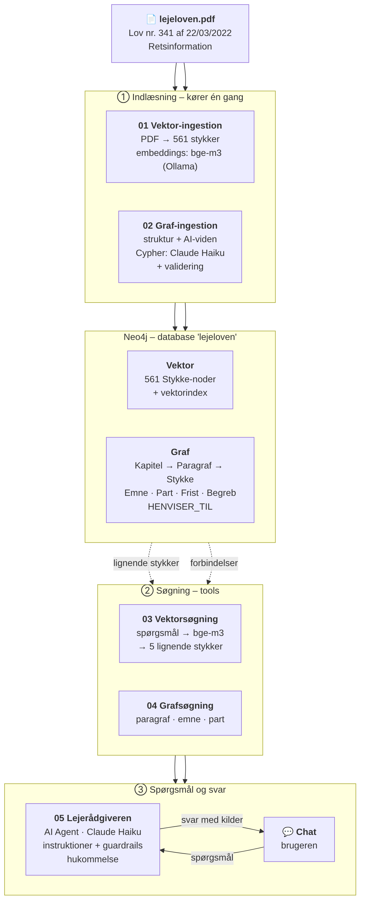

# RAG om dansk lejelovgivning (n8n + Neo4j)

**Lejerådgiveren** er en AI-agent, der svarer på spørgsmål om lejeloven for private
lejeboliger. Den søger i lovteksten med både vektorsøgning og grafsøgning i Neo4j og
svarer altid med kilder til paragraf og stykke.

## Case og agentens rolle

**Data:** Lejeloven (lov nr. 341 af 22. marts 2022) fra
[Retsinformation](https://www.retsinformation.dk/eli/lta/2022/341).

Lejeloven passer godt til både vektor og graf:
- **Vektor:** Folk beskriver deres situation med egne ord, fx "min udlejer vil have 5
  måneders depositum". Vektorsøgning finder de stykker, der betyder det samme.
- **Graf:** Loven har en fast struktur, paragrafferne henviser til hinanden, og de giver
  parterne rettigheder og pligter. Grafen kan fx svare på "hvilke pligter har udlejeren?".

**Rolle:** En saglig rådgiver, der forklarer reglerne i almindeligt dansk. Den svarer kun
ud fra lovteksten, slutter altid med kilder og giver ikke juridisk rådgivning i konkrete
sager. Se [agent/instruktioner.txt](agent/instruktioner.txt).

## Arkitektur



1. **Indlæsning:** Workflow 01 deler loven op i 561 stykker og gemmer dem med embeddings
   (bge-m3). Workflow 02 bygger grafen: strukturen med kode og viden (emner, parter,
   frister, begreber) med Claude Haiku, som skriver Cypher. Begge gemmer i samme
   Neo4j-database.
2. **Spørgsmål:** Brugeren skriver i n8n's chat. Agenten vælger selv mellem
   `vektorsoegning` (workflow 03) og `grafsoegning` (workflow 04).
3. **Svar:** Agenten svarer ud fra de hentede tekster og slutter med kilder.

## Opsætning

Jeg har kørt n8n 2.36.9 i Docker, Neo4j 2026.09.0 i Neo4j Desktop og Ollama på min
computer. n8n når Neo4j og Ollama via `host.docker.internal`.

1. Hent embedding-modellen: `ollama pull bge-m3`
2. Lav databasen `lejeloven` i Neo4j og kør
   [scripts/neo4j_setup.cypher](scripts/neo4j_setup.cypher) (constraints og vektorindex).
3. Kopiér PDF'en ind i n8n-containeren (min hedder `n8n-n8n-1`):
   ```
   docker exec n8n-n8n-1 mkdir -p /home/node/.n8n-files
   docker cp data/lejeloven.pdf n8n-n8n-1:/home/node/.n8n-files/lejeloven.pdf
   ```
4. Importér de 5 workflows fra [workflows/](workflows/) og opret credentials i n8n:
   HTTP Basic Auth til Neo4j og Anthropic API til Claude Haiku.
5. Kør workflow 01 og derefter 02. Publicér 03 og 04, og vælg dem i tool-noderne i 05.
6. Åbn chatten i workflow 05.

## Agent

Claude Haiku (`claude-haiku-5-5`) i n8n's AI Agent-node, med hukommelse (10 beskeder)
og to tools. Se [agent/](agent/) for instruktioner, tool-beskrivelser og modelvalg.

**Hvorfor ikke Agents builder?** Min n8n er version 2.36.9 og burde have Agents builder,
men Agents-fanen vises ikke, heller ikke under Settings, og den er ikke slået fra med
`N8N_DISABLED_MODULES`. Derfor har jeg brugt AI Agent-noden, som er bygget op på samme
måde: model, instruktioner, guardrails og workflows som tools.

## Hvor ligger hvad

| Krav | Fil |
|---|---|
| Workflows (JSON) | [workflows/](workflows/) |
| Screenshots af workflows | [screenshots/workflows/](screenshots/workflows/) (se tabellen herunder) |
| Screenshot af agentens tool-forbindelser | [screenshots/workflows/05_agent_tool_forbindelser.png](screenshots/workflows/05_agent_tool_forbindelser.png) |
| Screenshots fra Neo4j | [screenshots/neo4j/](screenshots/neo4j/) |
| Screenshots til eksemplerne | [screenshots/eksempel_1/](screenshots/eksempel_1/), [eksempel_2/](screenshots/eksempel_2/), [eksempel_3/](screenshots/eksempel_3/) |
| Agentens model, instruktioner og tools | [agent/](agent/) |
| Prompts fra udviklingen | [docs/udviklingsprompts.txt](docs/udviklingsprompts.txt) |
| Tre eksempler med vurdering | [docs/eksempler.md](docs/eksempler.md) |
| Grafmodel: noder, relationer, properties | [docs/graf_model.md](docs/graf_model.md) |
| Datakilde og sample | [data/](data/) |
| Scripts til at genskabe databasen | [scripts/](scripts/) |

## Workflows

| Workflow | Formål | JSON | Screenshot |
|---|---|---|---|
| 01 Vektor-ingestion | Dataindlæsning (vektor): PDF → stykker → embeddings → Neo4j | [JSON](workflows/01_vektor_ingestion.json) | [billede](screenshots/workflows/01_vektor_ingestion.png) |
| 02 Graf-ingestion | Dataindlæsning (graf): struktur med kode, viden med Claude Haiku | [JSON](workflows/02_graf_ingestion.json) | [billede](screenshots/workflows/02_graf_ingestion.png) |
| 03 Vektorsøgning | Retrieval (vektor): tool, der finder de 5 mest lignende stykker | [JSON](workflows/03_vektor_soegning.json) | [billede](screenshots/workflows/03_vektor_soegning.png) |
| 04 Grafsøgning | Retrieval (graf): tool, der slår en paragraf, et emne eller en part op | [JSON](workflows/04_graf_soegning.json) | [billede](screenshots/workflows/04_graf_soegning.png) |
| 05 Lejerådgiveren | Agenten: chat, Claude Haiku, hukommelse og de to tools | [JSON](workflows/05_lejeraadgiveren_agent.json) | [billede](screenshots/workflows/05_agent_tool_forbindelser.png) |

## Begrænsninger

- Lovteksten er fra 2022, så senere ændringer er ikke med.
- Agenten følger ikke altid alle henvisninger, og opdelingskoden fanger ikke henvisninger
  som "§§ 157 og 158" (se eksempel 3).
- Gamle fejl i hukommelsen kan få agenten til at stoppe med at bruge sine værktøjer
  (se eksempel 2).
- Grafens viden er udtrukket af AI og kan være ufuldstændig. Graf-ingestion gav viden til
  199 af 213 paragraffer. 10 blev afvist af valideringen, fordi AI'en fandt på emner, der
  ikke står på den faste liste (fx "Huslejens regulering"). 4 fejlede i Neo4j, fordi n8n
  sender flere paragraffer samtidig, så de støder ind i hinanden.
- Kun private lejeboliger, ikke almene boliger eller erhverv.

## Brug af AI

Jeg har brugt Claude som hjælp til at planlægge projektet, skrive kode til n8n-noderne
og finde fejl.
